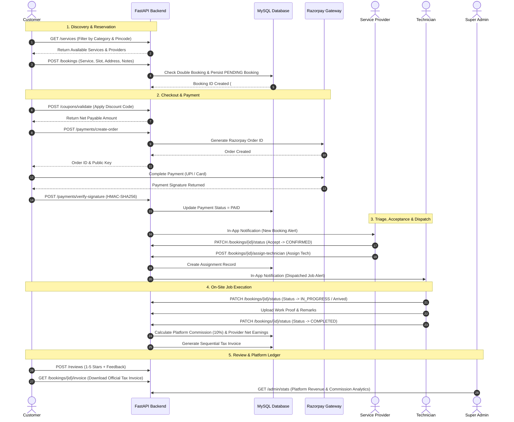
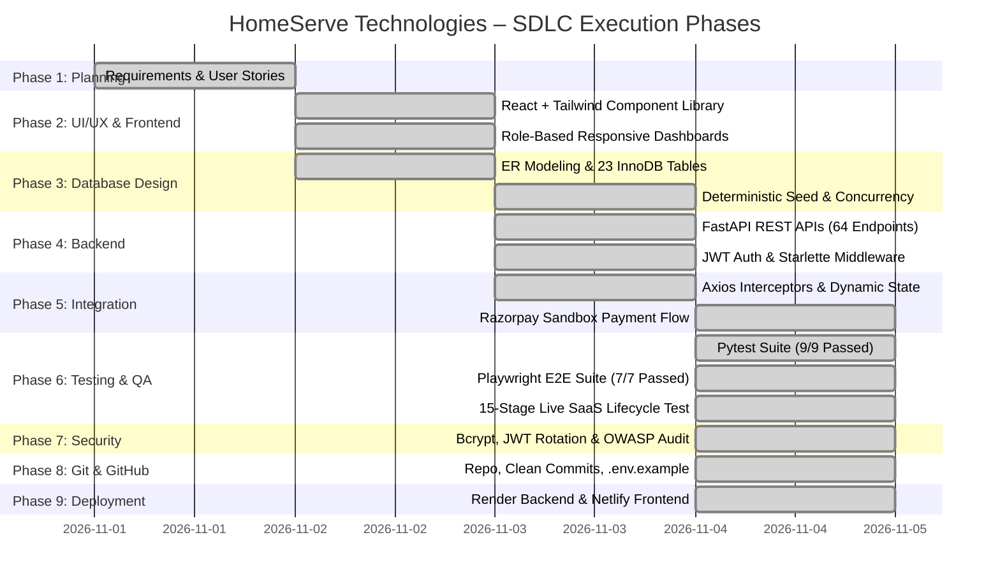

# HomeServe Technologies – User Stories, Workflows & Development Roadmap

**Project Phase**: Phase 1 – Requirement Analysis & Planning  
**Target Platform**: HomeServe Technologies (Enterprise Multi-Role SaaS)  
**Roles**: Super Admin, Customer, Service Provider, Technician

---

## 1. User Stories Matrix

### 1.1 Customer User Stories
- **US-CUST-01 (Discovery)**: *As a Customer*, I want to search and filter home services by category, keyword, and pincode, *so that* I can quickly locate verified professionals for my specific repair needs.
- **US-CUST-02 (Provider Vetting)**: *As a Customer*, I want to view service provider profiles, ratings, past customer reviews, and verification badges, *so that* I can trust the contractor I invite into my home.
- **US-CUST-03 (Slot Booking)**: *As a Customer*, I want to select a preferred date and time slot and provide my exact service address and problem description, *so that* the contractor arrives at my convenience.
- **US-CUST-04 (Promotional Discounts)**: *As a Customer*, I want to enter coupon codes (e.g., `HOMESERVE50`, `WELCOME100`), *so that* I can receive discounts on my total booking amount.
- **US-CUST-05 (Digital Payment)**: *As a Customer*, I want to pay securely via Razorpay (UPI, Cards, NetBanking), *so that* I have a tamper-proof digital payment receipt and zero cash handling hassles.
- **US-CUST-06 (Live Tracking)**: *As a Customer*, I want to track the real-time status of my booking (Pending $\to$ Confirmed $\to$ In Progress $\to$ Completed), *so that* I stay updated on technician arrival.
- **US-CUST-07 (Review & Dispute)**: *As a Customer*, I want to leave a 1-5 star review after service completion or raise a formal support complaint, *so that* my feedback is acknowledged.

### 1.2 Service Provider User Stories
- **US-PROV-01 (Onboarding)**: *As a Service Provider*, I want to register my business, specify trade specialties, and upload government licenses, *so that* I can become an approved contractor on the platform.
- **US-PROV-02 (Catalog & Pricing)**: *As a Service Provider*, I want to configure the services I offer, set custom base prices, define service areas, and set working hours, *so that* I receive bookings aligned with my capacity.
- **US-PROV-03 (Job Triage)**: *As a Service Provider*, I want to review incoming customer booking requests and either Accept or Reject them with a reason, *so that* I maintain quality schedules.
- **US-PROV-04 (Fleet Dispatch)**: *As a Service Provider*, I want to assign certified technicians from my workforce to confirmed bookings, *so that* field execution is delegated efficiently.
- **US-PROV-05 (Earnings Ledger)**: *As a Service Provider*, I want to view gross earnings, automated platform commission deductions, and net payout balances, *so that* I have full financial transparency.

### 1.3 Field Technician User Stories
- **US-TECH-01 (Job Queue)**: *As a Technician*, I want to access a mobile-optimized view of my assigned jobs with customer addresses, contact numbers, and issue notes, *so that* I can navigate directly to the job site.
- **US-TECH-02 (Execution Stepper)**: *As a Technician*, I want to mark when I have arrived on site and when work is completed, *so that* customer and provider are notified in real time.
- **US-TECH-03 (Completion Proof)**: *As a Technician*, I want to upload completion notes and job photos, *so that* work quality is verified before job closure.

### 1.4 Super Admin User Stories
- **US-ADM-01 (Provider Verification)**: *As a Super Admin*, I want to inspect submitted contractor documents and Approve or Reject applications, *so that* only qualified contractors operate on the platform.
- **US-ADM-02 (Master Catalog)**: *As a Super Admin*, I want to manage categories, subcategories, standard platform services, and base rates, *so that* the marketplace stays organized.
- **US-ADM-03 (Executive KPIs)**: *As a Super Admin*, I want to monitor platform revenue, completed bookings, active contractors, commission earnings, and customer growth analytics, *so that* I can steer platform strategy.
- **US-ADM-04 (Dispute Intervention)**: *As a Super Admin*, I want to review customer complaints, inspect booking audit trails, and intervene to resolve disputes, *so that* marketplace trust is maintained.

---

## 2. Business Workflow Diagrams

### 2.1 End-to-End Booking & Service Fulfillment Workflow

---

## 3. Module List & Functional Mapping

| Module # | Module Name | Primary Actors | Core Database Entities | Key Endpoints |
| :---: | :--- | :--- | :--- | :--- |
| **01** | **Authentication & RBAC** | All 4 Roles | `users`, `refresh_tokens` | `/auth/login`, `/auth/register/*`, `/auth/refresh` |
| **02** | **Customer Management** | Customer, Admin | `customers`, `addresses`, `favorites` | `/customers/addresses`, `/customers/favorites` |
| **03** | **Service Catalog** | All Roles | `service_categories`, `services` | `/categories`, `/services` |
| **04** | **Provider Management** | Provider, Admin | `service_providers`, `provider_services`, `service_areas` | `/providers`, `/admin/providers/{id}/verify` |
| **05** | **Booking & Scheduling** | Customer, Provider | `bookings`, `availability_slots` | `/bookings`, `/bookings/{id}/status` |
| **06** | **Technician Management** | Provider, Tech | `technicians`, `booking_assignments` | `/technicians`, `/bookings/{id}/assign-technician` |
| **07** | **Payment & Invoicing** | Customer, Provider | `payments`, `invoices`, `coupons`, `provider_earnings` | `/payments/*`, `/coupons/*`, `/bookings/{id}/invoice` |
| **08** | **Notifications** | All Roles | `notifications` | `/notifications`, `/notifications/{id}/read` |
| **09** | **Reviews & Complaints**| Customer, Provider, Admin | `reviews`, `complaints` | `/reviews`, `/complaints` |
| **10** | **Analytics & Reports** | Admin, Provider | Aggregated Ledger | `/admin/stats`, `/providers/me/earnings` |

---

## 4. Complete SDLC Development Roadmap

